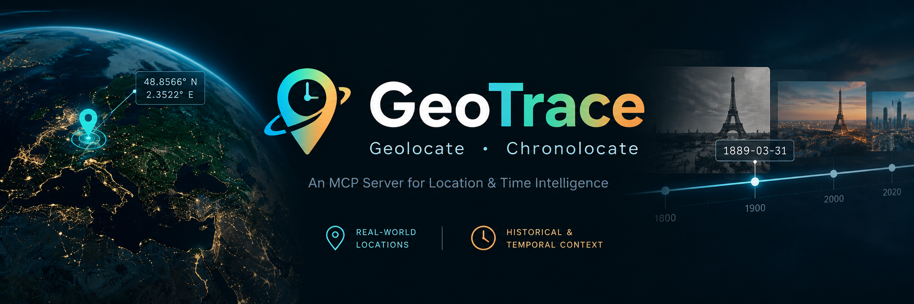

<p align="center">
  
</p>

<div align="center">

### MCP for open source content verification from images

**Get the position and the time of any picture**
</div>

## About GeoTrace

GeoTrace allows you to find the where and the when an image was taken. The main purpose of this work is educational and, in case it can, to help journalists and OSINT experts in the research of criminal activity and similar. My interest in OSINT started with Sofia Santos and bellingcat challenges, whose I share their vision of revealing human rights violations all around the world in order to concern people and authorities about them. Therefore, this project aims to provide a tool to people wanting to collaborate in this tasks.

## Tools

| # | Tool | Category | Description |
|---|------|----------|-------------|
| 1 | `view_image` | Image inspection | Returns the image so the model can describe its visual clues. With `grid=True` it draws a labelled grid on a copy, so you can name cells like `C2` for other tools. |
| 2 | `zoom_image` | Image inspection | Crops a cell or region from the original full-resolution file to read small details such as signs and plates. Small crops are upscaled, which adds no new detail. |
| 3 | `extract_metadata` | Image inspection | Reads EXIF metadata, camera data and GPS from an image URL or a local file path. |
| 4 | `extract_text` | Text / OCR | Reads text with EasyOCR, either over the whole image or in one cell or region. Returns text blocks with confidence, bbox and relative size, merges nearby words, and can also read rotated text and non-Latin scripts. |
| 5 | `find_named_features` | OpenStreetMap | Searches OSM inside a bounding box for features whose name contains a given text, such as a shop or street name found by OCR. Matching ignores case and accents. Returns up to 25 results nearest the box centre. |
| 6 | `overpass_query` | OpenStreetMap | Runs a custom Overpass QL query inside a bounding box. The size limit depends on how rare the feature is (10–2500 km²) and every filter must use `{{bbox}}`. Returns OSM JSON elements. |
| 7 | `location_guesser_yfcc` | Geolocation (AI) | General-purpose location estimate for any image. Returns probable regions with a probability, centre, radius and country, plus a localizability rating. |
| 8 | `location_guesser_osv` | Geolocation (AI) | Location estimate for street-level photos (roads, buildings, signs) using StreetCLIP. Output format is the same as the other guessers. |
| 9 | `location_guesser_inat` | Geolocation (AI) | Location estimate for nature photos (plants, animals, landscapes). Output format is the same as the other guessers. |
| 10 | `reverse_search_image` | Web search | Reverse image search on the full image or one region, for landmarks, buildings, logos and signs only, never faces. Uses SerpApi (Google Lens) or Google Cloud Vision, may cost paid credits, and repeated crops are served from cache. |
| 11 | `verify_candidate_locations` | Verification | Checks candidate coordinates against nearby Mapillary photos: ranks them with MegaLoc, then confirms geometrically with LightGlue and RANSAC. Stops at the first match and needs `MAPILLARY_TOKEN`. |
| 12 | `compare_images` | Verification | Checks whether two images show the same place using LightGlue and RANSAC geometry only. The verdict is `match`, `similar` or `no_match`. |
| 13 | `relative_sun_position_from_outdoor_lighting` | Sun analysis | Estimates sun altitude and azimuth relative to the camera from the scene's lighting, using a DINOv2 model. Typical error is about 1.6° for altitude and 5.6° for azimuth. |
| 14 | `relative_sun_position_from_shadows` | Sun analysis | Estimates sun direction and elevation from object–shadow pairs, with the camera calibrated by GeoCalib. It is precise only when the confidence (`pair_score`) is high. |
| 15 | `location_from_sun_position` | Sun analysis | Takes a UTC date/time plus sun elevation and azimuth, and returns the possible latitude/longitude (usually two mirror-image solutions). |
| 16 | `time_from_sun_position` | Sun analysis | Takes a location plus sun elevation and azimuth, and returns the likely UTC dates and times, best match first. |
| 17 | `time_from_objects` | Dating | Estimates when each named object was built using EVA02-CLIP time probing. This gives a "photo taken no earlier than" year. |
| 18 | `inspect_calibration` | Diagnostics | Runs GeoCalib and returns its raw outputs: focal length, field of view, gravity vector, roll and pitch, and their uncertainties. |

## Install

GeoTrace is a local stdio MCP server. Every harness starts it with the same [`uvx`](https://docs.astral.sh/uv/) command, so the only requirement is [uv](https://docs.astral.sh/uv/getting-started/installation/):

```bash
uvx --python 3.12 --from git+https://github.com/davidlnk3/GeoTrace@v0.2.0 geotrace
```

`--python 3.12` keeps every machine on the same interpreter (PLONK's pinned scipy and some PyTorch builds lag behind newer Python versions). The `@v0.2.0` tag pins the release: uvx caches the install, so change the tag to upgrade.

### Choose the tools you need

The base install starts the server and runs every tool that needs no machine-learning model. The other tools need an extra, and until it is installed they return an error with the command to add it. To install extras, put them in brackets after `geotrace` and quote the whole `--from` value:

```bash
uvx --python 3.12 --from 'geotrace[ocr,verification] @ git+https://github.com/davidlnk3/GeoTrace@v0.2.0' geotrace
```

| Extra | Tools | Notes |
|-------|-------|-------|
| `ocr` | `extract_text` | EasyOCR models download to `~/.EasyOCR/` on first use |
| `reverse-search` | `reverse_search_image` | OpenCV, for the face check |
| `calibration` | `relative_sun_position_from_shadows`, `inspect_calibration` | GeoCalib and PyTorch |
| `verification` | `verify_candidate_locations`, `compare_images` | PyTorch, LightGlue and OpenCV |
| `sun` | `relative_sun_position_from_outdoor_lighting` | PyTorch and transformers. Weights download from [`davidlnk3/geotrace-sun`](https://huggingface.co/davidlnk3/geotrace-sun) on first use |
| `geoclip` | `time_from_objects` | PyTorch and open_clip. EVA02-CLIP weights download on first use |
| `plonk` | `location_guesser_*` | PLONK and reverse_geocoder. Needs Python 3.12 or older |
| `all` | every tool except `location_guesser_*` | add `plonk` for those: `geotrace[all,plonk]` |

The extras with PyTorch download several GB. Run the command once in a terminal before adding it to a harness: the first install can take longer than the harness waits for a server to start. Later starts reuse the cache.

### Add it to your harness

Each snippet uses the base install. For extras, replace the `--from` value with the bracketed form above. `env` is optional: add only the keys you use (see [Environment variables](#environment-variables)).

**Claude Code**

```bash
claude mcp add geotrace --scope user -e HF_TOKEN=hf_... -- uvx --python 3.12 --from git+https://github.com/davidlnk3/GeoTrace@v0.2.0 geotrace
```

**Codex**

```bash
codex mcp add geotrace --env HF_TOKEN=hf_... -- uvx --python 3.12 --from git+https://github.com/davidlnk3/GeoTrace@v0.2.0 geotrace
```

or in `~/.codex/config.toml`:

```toml
[mcp_servers.geotrace]
command = "uvx"
args = ["--python", "3.12", "--from", "git+https://github.com/davidlnk3/GeoTrace@v0.2.0", "geotrace"]
startup_timeout_sec = 60
env = { HF_TOKEN = "hf_..." }
```

**Claude Desktop, Cursor and other `mcpServers` clients** (`claude_desktop_config.json`, `~/.cursor/mcp.json`, ...):

```json
{
  "mcpServers": {
    "geotrace": {
      "command": "uvx",
      "args": ["--python", "3.12", "--from", "git+https://github.com/davidlnk3/GeoTrace@v0.2.0", "geotrace"],
      "env": { "HF_TOKEN": "hf_..." }
    }
  }
}
```

Desktop apps on macOS may not see your shell's `PATH`. If the server fails to start, set `"command"` to the full path printed by `which uvx`.

**OpenClaw** (`~/.openclaw/openclaw.json`):

```json
{
  "mcp": {
    "servers": {
      "geotrace": {
        "command": "uvx",
        "args": ["--python", "3.12", "--from", "git+https://github.com/davidlnk3/GeoTrace@v0.2.0", "geotrace"],
        "env": { "HF_TOKEN": "hf_..." }
      }
    }
  }
}
```

**Hermes Agent** (`~/.hermes/config.yaml`, then `/reload-mcp` in a running session). Hermes passes only the variables listed in `env` to the server:

```yaml
mcp_servers:
  geotrace:
    command: uvx
    args: ["--python", "3.12", "--from", "git+https://github.com/davidlnk3/GeoTrace@v0.2.0", "geotrace"]
    env:
      HF_TOKEN: hf_...
```

### Environment variables

Set them in the harness's `env` block for GeoTrace, then restart the harness or reload its MCP servers.

- `SERPAPI_API_KEY` / `GOOGLE_VISION_API_KEY`: used by `reverse_search_image`. Set either one or both. Get the SerpApi key at [serpapi.com](https://serpapi.com). For Cloud Vision, enable the Cloud Vision API with billing on and create a key, ideally restricted to that API. If only the Cloud Vision key is set, the tool falls back to it.
- `MAPILLARY_TOKEN`: used by `verify_candidate_locations`. Register an application in the [Mapillary developer dashboard](https://www.mapillary.com/dashboard/developers) (read access is enough) and copy its client access token.
- `HF_TOKEN` (optional): your Hugging Face token. The SSIS and MegaLoc Spaces then use your account's ZeroGPU quota instead of the small anonymous one.
- `GEOTRACE_RETRIEVAL_BACKEND=space` (optional): runs MegaLoc ranking on a GPU in the [`davidlnk3/megaloc-descriptors`](https://huggingface.co/spaces/davidlnk3/megaloc-descriptors) Space (source in `hf_space/megaloc/`) instead of locally. `GEOTRACE_MEGALOC_SPACE` selects another Space with the same API. The Space receives the query image, so don't use it for images that must not leave your machine.
- `GEOTRACE_SUN_CHECKPOINT` (optional): path to a local copy of the sun model's `best.pt`, for machines that cannot reach Hugging Face.

> **About SerpApi.** SerpApi is a third-party paid service that scrapes Google results, and each search uses credits from your plan. Google sued SerpApi in December 2025, and the case was still pending at last check, so the service could stop working at any time. Google Cloud Vision Web Detection is the official alternative.

## License

GeoTrace is licensed under MIT License. See LICENSE.

## Third-party components

| Component | Used for | License |
|---|---|---|
| [SSIS / SSISv2](https://github.com/stevewongv/SSIS) | Object-shadow pair detection, run in a separate Hugging Face Space | **Non-commercial use only** |
| [GeoCalib](https://github.com/cvg/GeoCalib) | Camera calibration (gravity direction and focal length) to correct perspective in shadow measurements | Code: Apache 2.0 · Model weights: [CC BY 4.0](https://creativecommons.org/licenses/by/4.0/) |
| [All-Weather Deep Outdoor Lighting Estimation](https://openaccess.thecvf.com/content_CVPR_2019/html/Zhang_All-Weather_Deep_Outdoor_Lighting_Estimation_CVPR_2019_paper.html) | Sun-position inference as backup to object-shadow pair detection | Independent implementation, see below |
| [A Matter of Time](https://arxiv.org/abs/2510.19559) (Tekaya et al., 2025) and [EVA02-CLIP](https://github.com/baaivision/EVA) via [open_clip](https://github.com/mlfoundations/open_clip) | Time probing for `time_from_objects` | Method from the paper; weights downloaded at first use, not redistributed |
| [PLONK](https://arxiv.org/abs/2412.06781), [code](https://github.com/nicolas-dufour/plonk) | Regions and probabilities for `location_guesser_yfcc` (YFCC), `location_guesser_inat` (iNaturalist) and `location_guesser_osv` (OSV-5M) | Code: MIT · Weights: downloaded at first use from Hugging Face, not redistributed; check the model card licence |
| [reverse_geocoder](https://github.com/thampiman/reverse-geocoder) (GeoNames data) | Nearest place name, admin region and country code for `location_guesser_yfcc` | LGPL; data under GeoNames' CC BY 4.0 |
| [EasyOCR](https://github.com/JaidedAI/EasyOCR) (Jaided AI) | Text detection and recognition for `extract_text` (optional `ocr` extra) | Apache 2.0; models downloaded at first use, not redistributed |
| [OpenStreetMap](https://www.openstreetmap.org/copyright) data via the [Overpass API](https://wiki.openstreetmap.org/wiki/Overpass_API) | `overpass_query` and `find_named_features` | Data © OpenStreetMap contributors, [ODbL 1.0](https://opendatacommons.org/licenses/odbl/) |
| [Mapillary](https://www.mapillary.com) | Street-level reference photos for `verify_candidate_locations`, fetched at run time through the Mapillary API | Imagery: [CC BY-SA 4.0](https://creativecommons.org/licenses/by-sa/4.0/); API use under the Mapillary terms |
| [MegaLoc](https://github.com/gmberton/MegaLoc) (Berton & Masone, CVPRW 2025) | Ranking the Mapillary photos by visual similarity | Code: MIT · Weights ([gberton/MegaLoc](https://huggingface.co/gberton/MegaLoc)): MIT; downloaded at first use, not redistributed. Optionally run in the `davidlnk3/megaloc-descriptors` Space |
| [LightGlue](https://github.com/cvg/LightGlue) with [ALIKED](https://github.com/Shiaoming/ALIKED) features | Feature matching for the geometric verification in `verify_candidate_locations` and `compare_images` | LightGlue code and weights: Apache 2.0 · ALIKED: BSD 3-Clause · Weights downloaded at first use, not redistributed. SuperPoint, whose licence is non-commercial, is not used |

### OpenStreetMap

Map data returned by `overpass_query` and `find_named_features` is © OpenStreetMap contributors and available under the Open Database License (ODbL). See https://www.openstreetmap.org/copyright.

### SSIS

Shadow detection uses SSIS / SSISv2 (Wang et al., CVPR 2021, TPAMI 2022),
https://github.com/stevewongv/SSIS, which is licensed for non-commercial use only.
It runs in a separate Hugging Face Space (davidlnk3/ssis-demo) that keeps the
original license and includes modifications described there.
For commercial use of SSIS, contact its authors.
The Space is public and is called anonymously by default. Set `HF_TOKEN` (optional) to use your account's ZeroGPU quota instead of the small anonymous one.

### GeoCalib

GeoCalib is used unmodified as a dependency. Its weights are downloaded from the
official source on first use and are not redistributed with GeoTrace.

### All-Weather Deep Outdoor Lighting Estimation

Reimplementation of the sun-position part of *All-Weather Deep Outdoor Lighting Estimation* (Zhang et al., CVPR 2019). It is an independent implementation, not the authors' code, and it departs from the paper in several ways: a DINOv2-small backbone, sun labels from astral and the brightest pixel instead of PanoNet estimates, and crops that keep the sun outside the frame.

### Mapillary, MegaLoc and LightGlue

`verify_candidate_locations` downloads Mapillary thumbnails at run time and does not store or redistribute them. Only MegaLoc descriptors (numbers, not images) are cached locally, keyed by Mapillary image id. Mapillary imagery is licensed under CC BY-SA 4.0: if you publish a Mapillary photo found by the tool, credit Mapillary and the contributor, and link the image (`https://www.mapillary.com/app/?pKey=<reference_id>`).

MegaLoc is loaded with `torch.hub` from `gmberton/MegaLoc` and LightGlue is installed from `cvg/LightGlue`, both pinned to a commit and used unmodified. LightGlue can also run with DISK features (Apache 2.0, as stated in the LightGlue README), selected in `core/matching.py`.

Berton, G., & Masone, C. (2025). MegaLoc: One Retrieval to Place Them All. CVPR Workshops.
Lindenberger, P., Sarlin, P.-E., & Pollefeys, M. (2023). LightGlue: Local Feature Matching at Light Speed. ICCV.
